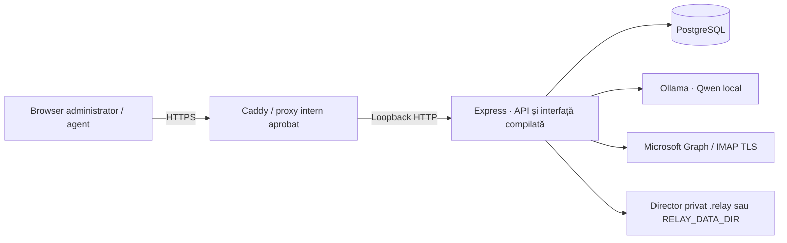

# Arhitectură tehnică

[Documentație](README.md) · [Model de date](data-model.md) · [Securitate](security.md) · [API](api.md)

## 1. Model de găzduire

Relay este o aplicație web cu backend și model AI pe infrastructura aleasă de client. Browserul agentului comunică cu backendul; nu se conectează direct la PostgreSQL, Ollama sau furnizorii email.

Profilul corporativ livrat presupune Caddy și backend pe același calculator. Dacă IT folosește alt proxy sau separă componentele, configurația de transport și încredere trebuie reevaluată. Nu există un orchestrator de cluster sau o topologie de înaltă disponibilitate livrată.

## 2. Componente și surse

| Componentă           | Responsabilitate                                  | Implementare                                                                                                                                            |
| -------------------- | ------------------------------------------------- | ------------------------------------------------------------------------------------------------------------------------------------------------------- |
| Interfață            | Login, listă, detaliu, echipă și navigație        | [src/main.jsx](../src/main.jsx)                                                                                                                         |
| ITL / EMMA / conturi | Ecrane specializate                               | [WorkflowSettings.jsx](../src/WorkflowSettings.jsx), [TaskResources.jsx](../src/TaskResources.jsx), [SecuritySettings.jsx](../src/SecuritySettings.jsx) |
| API                  | Autentificare, autorizare, validare și rute       | [server/app.js](../server/app.js), [server/workflows.js](../server/workflows.js)                                                                        |
| Persistență          | Conexiuni, tranzacții și migrări                  | [server/db.js](../server/db.js)                                                                                                                         |
| Taskuri              | Deduplicare, conversații, repartizare, evenimente | [server/messages.js](../server/messages.js)                                                                                                             |
| Conectori            | OAuth/Graph, IMAP și normalizare mesaje           | [server/mail-providers.js](../server/mail-providers.js)                                                                                                 |
| Monitorizare         | Configurații, checkpoint și import                | [server/mail-service.js](../server/mail-service.js)                                                                                                     |
| Worker AI            | Coada persistentă și execuția serializată         | [server/ai-runner.js](../server/ai-runner.js)                                                                                                           |
| Context și AI        | Exemple verificate, contract JSON și apel Ollama  | [server/context.js](../server/context.js), [server/ollama.js](../server/ollama.js)                                                                      |
| ITL                  | Extragere PDF, fragmente și căutare SQL           | [server/knowledge.js](../server/knowledge.js)                                                                                                           |
| EMMA                 | Parsare XLSX și taskuri după cod                  | [server/excel.js](../server/excel.js), [server/emma.js](../server/emma.js)                                                                              |
| Secrete              | Criptarea credențialelor email                    | [server/vault.js](../server/vault.js)                                                                                                                   |
| Pornire HTTPS        | Validarea profilului și proxy                     | [server/https-config.js](../server/https-config.js), [deploy/Caddyfile](../deploy/Caddyfile)                                                            |

## 3. Flux de import și clasificare

1. Workerul verifică periodic conexiunile activate și ajunse la termenul de polling.
2. Conectorul citește un lot din Inbox pornind de la checkpoint, cu acces de citire.
3. Mesajul este normalizat și persistat înainte de checkpointul nou. Identificatorul sursei previne importul repetat.
4. O actualizare poate completa conversația existentă. Un raport EMMA potrivit este procesat după reguli deterministe.
5. Un task email nou neconfirmat intră în `processing_jobs`, dacă nu a fost deja alocat.
6. Workerul alege un job, încarcă skillurile și contextul organizației și cere clasificarea locală.
7. Răspunsul JSON este validat. Competența trebuie să existe în organizație.
8. Într-o tranzacție, se verifică din nou că taskul nu a fost modificat de om și se înregistrează clasificarea/alocarea.
9. Checkpointul sursei este păstrat în SQL. Interfața vede schimbările la reîncărcarea periodică.

Reimportul după o întrerupere nu creează alt task pentru același identificator. Inserarea unui email rămas fără job înainte de checkpoint poate fi recuperată la reluarea importului. Checkpointul nu este un mecanism de backup sau o dovadă de procesare în sistemul de business.

## 4. Concurență și recuperare

Distribuirea din aceeași organizație este serializată prin blocarea rândului organizației, astfel încât două repartizări automate să nu depășească simultan capacitatea. Rândurile taskurilor se verifică/blochează înainte de modificare.

Inferența folosește un lock PostgreSQL comun testului AI, workerului și asistenței ITL. Modelul nu rulează în paralel pentru aceste fluxuri în aceeași bază de date. Starea jobului este persistentă, dar lockul de proces nu constituie un sistem de planificare distribuită cu SLA.

| Situație                                    | Comportament                                                                                                |
| ------------------------------------------- | ----------------------------------------------------------------------------------------------------------- |
| Ollama indisponibil                         | Taskul rămâne în SQL; erorile tranzitorii eligibile au maximum 3 încercări automate                         |
| Proces oprit în timpul unui job             | Jobul running poate fi recuperat după expirarea lease-ului de 15 minute                                     |
| Tag confirmat / task alocat între timp      | Rezultatul AI este anulat sau ignorat, fără suprascrierea deciziei umane                                    |
| Corp schimbat în timpul inferenței inițiale | Rezultatul vechi nu se aplică; jobul poate fi reîncercat cu noul conținut                                   |
| Nu există agent liber                       | Taskul eligibil așteaptă; coada este verificată ulterior fără reclasificare                                 |
| Eroare de autorizare email                  | Eroarea se păstrează; conexiunea poate fi oprită și necesită reconectare                                    |
| Test AI manual întrerupt                    | Taskul salvat rămâne pentru verificare; fluxul manual nu este identic cu un job de monitorizare recuperabil |

Timerul workerelor este de aproximativ 5 secunde; conexiunea email are propriul interval, implicit 60 secunde. UI-ul se reîncarcă aproximativ la 30 secunde. Aceste intervale și timpul de inferență se cumulează; nu reprezintă promisiunea unui timp maxim de alocare.

## 5. Conversații și atașamente

Outlook folosește conversationId; Gmail/Yahoo folosesc Message-ID și referințele de răspuns. Asocierea are domeniul aceleiași căsuțe. Subiectul singur nu unește taskuri, iar referințele ambigue nu produc o unire automată între două taskuri.

`messages` reprezintă taskul; `mail_entries` păstrează emailurile conversației. Corpul taskului urmărește mesajul recent, iar conversația conservă intrările. Importul unui email istoric nu înlocuiește conținutul mai recent. Atașamentele sunt stocate binar în SQL și autorizate la descărcare.

## 6. ITL și EMMA

ITL este un flux de recuperare de context: PDF → text pe pagini → fragmente → căutare lexicală SQL → generare la cererea agentului. Sunt returnate sursele și citatele, validate textual. Nu există embeddings, OCR sau execuție automată de proceduri.

EMMA este un flux de reguli: expeditor/subiect → foaie/antet/coloană → coduri configurate → task pe rând. Nu folosește Qwen pentru alegerea rândurilor. Identitatea atașamentului/rândului previne dublarea la reaplicare; nu recunoaște aceeași eroare într-un alt raport săptămânal fără o cheie de business suplimentară.

## 7. Granițe și dependențe externe

SQL și AI pot rămâne pe aceeași gazdă. Conectorii email folosesc serviciile externe ale furnizorilor. Instalarea dependențelor și descărcarea modelului sunt operații distincte de procesarea locală în exploatare.

Cheia credențialelor se află în directorul privat de date, nu în SQL. Restaurarea bazei fără cheia corespunzătoare nu restaurează accesul la email. DNS, certificate, ACL, EDR, SSO/MFA și pornirea ca serviciu sunt responsabilități de infrastructură sau integrări încă neincluse.
