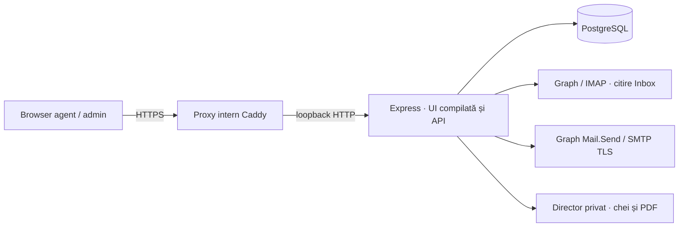

# Arhitectură tehnică

[Documentație](README.md) · [Model de date](data-model.md) · [Securitate](security.md)

## Componente și fluxuri

Backendul nu încarcă modele, nu apelează Ollama și nu trimite documente unui serviciu AI. Codul vechi rămâne în archive/ai, neimportat de runtime. Căutarea ITL și a rezolvărilor folosește termeni și full-text PostgreSQL.

| Componentă                        | Sursă                                                |
| --------------------------------- | ---------------------------------------------------- |
| Reguli și decizii                 | server/rules.js                                      |
| Cozi, polling, recuperare         | server/workers.js                                    |
| Taskuri, conversații, echilibrare | server/messages.js                                   |
| Rezolvări și transferuri          | server/collaboration.js                              |
| Identități personale și outbox    | server/sender-service.js                             |
| Expediere Graph/SMTP              | server/send-providers.js                             |
| Import și checkpointuri           | server/mail-service.js, server/mail-providers.js     |
| ITL / EMMA                        | server/knowledge.js, server/emma.js, server/excel.js |
| Securitate și API                 | server/app.js, server/security.js, server/vault.js   |

## Import și dispecerizare

Conectorul citește Inbox și persistă fiecare email înainte de avansarea checkpointului. Identificatorul stabil previne importul repetat. O referință RFC sau conversationId poate actualiza un task existent; subiectul singur nu unește mesaje. Rapoartele EMMA eligibile sunt procesate separat după coduri.

Un task email nou intră în dispatch_jobs. Workerul evaluează regulile active ale organizației. Prioritatea minimă câștigă; skilluri diferite la aceeași prioritate produc conflict. Nicio potrivire sau conflictul lasă taskul nealocat pentru verificare. Decizia păstrează un snapshot al regulilor potrivite; ștergerea regulii nu șterge explicația.

Pentru o categorie stabilită prin regulă sau de om, alocarea alege agentul activ și disponibil cu acel skill, sub capacitate, cu cele mai puține taskuri deschise. La egalitate se preferă cel care nu a primit recent o alocare. Se numără toate taskurile deschise, inclusiv EMMA și alte skilluri. Org-lock și task-lock serializează alocările. Un task deja alocat nu este mutat pentru egalizare.

Workerele de polling, reguli și email rulează independent, la aproximativ 5 secunde; conexiunile email au interval propriu, implicit 60 secunde. Un job de reguli întrerupt se recuperează după lease de 2 minute; erorile au maximum 3 încercări, la 30 secunde. Lipsa potrivirii este un rezultat final, nu eroare temporară. Adminul poate cere reevaluare numai pentru taskuri Nou, nealocate și neconfirmate. Deciziile umane nu sunt suprascrise.

## Colaborare și răspunsuri

Rezolvările sunt înregistrări SQL cu autor, rezumat, pași și alegerea de partajare. Numai cele partajate, pe taskuri rezolvate și cu același skill când acesta există sunt candidate pentru sugestii; se returnează maximum 5 după căutare lexicală, fără corpul emailului original. ITL este accesibil la nivelul organizației.

Transferul explicit cere un coleg activ din organizație și motiv. Păstrează tagul, conversația, fișierele și notele, schimbă responsabilul și starea la Nou și anulează coada netrimisă. Competența și capacitatea nu sunt restricții pentru acest transfer manual.

Fiecare utilizator își autorizează contul propriu de expediere. Outboxul fixează expeditorul, destinatarul inițial, referințele RFC și versiunea identității autorizate. Nu acceptă adrese arbitrare din composer. Furnizorul este apelat numai după salvarea cererii și reverificarea drepturilor/identității. Advisory lock per utilizator protejează configurarea și refresh tokenul.

Acceptarea externă și commitul SQL nu sunt o singură tranzacție. Trimiterea incertă sau lease-ul expirat devine unknown, fără retry automat. Operatorul verifică și consemnează rezultatul; aceasta nu este o interogare automată Sent. 202 de la Graph înseamnă acceptat, nu livrat. In-Reply-To/References leagă de original, Reply-To conduce spre căsuța monitorizată; afișarea conversației în client depinde și de furnizor.

## Găzduire și operare

Proxy-ul și backendul profilului HTTPS livrat sunt pe aceeași gazdă. PostgreSQL rămâne pe loopback; agenții folosesc browserul, nu se conectează la SQL. Infrastructura, serviciile Windows, DNS, certificatele, Zscaler și aprobarea permisiunilor Microsoft sunt administrate cu IT. Nu există instalator de servicii sau HA livrat.

Secretele email sunt criptate cu AES-256-GCM, cheia fiind într-un director privat separat de SQL. Restaurarea necesită baza și cheia. O copie restaurată include cozi de trimitere, deci se testează izolată de furnizori. Vezi [operare](operations.md).
