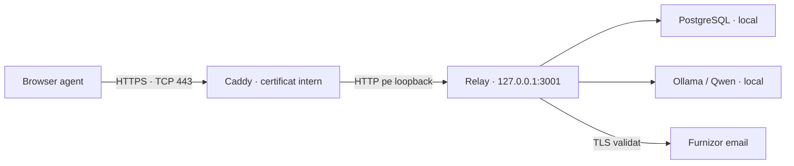

# HTTPS intern și pregătirea pilotului corporativ

[Documentație](README.md) · [Manual administrator](administrator-guide.md) · [Depanare](troubleshooting.md)

Acest ghid pregătește o instalare pentru evaluarea IT/Cyber Security. Nu certifică aplicația și nu demonstrează acceptarea de către Zscaler sau politicile companiei. HTTPS protejează traficul browser–aplicație; nu creează rutarea între calculatoare și nu înlocuiește SSO/MFA, EDR/antivirus, backupurile sau un audit.

## Arhitectura pregătită



Pe server, Caddy 2 servește drept proxy. Numai el primește conexiuni din rețea. Backendul este legat strict de 127.0.0.1; în profilul HTTPS nu pornește cu HOST=0.0.0.0 sau cu încredere arbitrară în proxy-uri. Cererile HTTP către aplicație sunt refuzate, cu excepția endpointului local de health pentru diagnostic. HTTP pe loopback rămâne între două procese ale aceluiași calculator. Dacă IT cere criptare și pe loopback, terminarea TLS trebuie adaptată împreună cu infrastructura lor.

Caddy înlocuiește antetele forwarded furnizate de client. Express are exact un proxy local de încredere. Sunt active cookie Secure/HttpOnly/SameSite=Strict, antete CSP/HSTS și refuzarea originilor de scriere care nu sunt configurate explicit. HSTS se aplică doar numelui aplicației, fără subdomenii. Nu există redirect automat de pe portul 80: se distribuie direct linkul HTTPS, iar portul 80 poate rămâne închis. Nu se cere un certificat de la un CA public și nu se deschide automat aplicația pe Internet.

## Nume stabil și IP dinamic

Un certificat se emite pentru numele DNS, de exemplu `relay.departament.domeniul-intern-al-firmei`. Schimbarea IP-ului nu cere alt certificat cât timp numele rămâne identic și DNS-ul este actualizat corect. Exemplele din repository folosesc `relay.example.test`, un nume de test; nu este o adresă deja disponibilă.

IT poate configura o rezervare DHCP, actualizarea dinamică a DNS-ului sau un serviciu/proxy intern stabil. O intrare hosts cu IP fix nu rezolvă schimbarea IP-ului. Un Cloud PC poate avea o adresă privată într-o rețea virtuală fără acces direct de la colegi; este necesară o cale de acces internă aprobată. Dacă se folosește Zscaler Private Access sau alt gateway, IT stabilește publicarea și conectivitatea. Aplicația nu configurează Zscaler și nu îi ocolește politicile.

## Ce trebuie stabilit cu IT înainte de activare

- Calculatorul/VM-ul aprobat să găzduiască aplicația și dacă are voie să primească trafic de la colegi. Un laptop/Cloud PC de utilizator poate să nu fie acceptat ca server.
- Numele DNS intern stabil și modul de actualizare a adresei.
- Certificatul pentru acel nume, lanțul de certificate și cheia privată PEM, sau terminarea TLS la proxy-ul aprobat al companiei. Certificatul trebuie recunoscut de calculatoarele agenților; simpla generare a unuia self-signed nu este suficientă.
- Acces TCP 443 din segmentele/grupurile aprobate către proxy. Fără expunerea 3001, 5432 sau 11434 în rețea și fără port forwarding public.
- Destinațiile email necesare: Microsoft `login.microsoftonline.com:443`, `graph.microsoft.com:443`; Gmail `imap.gmail.com:993`; Yahoo `imap.mail.yahoo.com:993`. Nu se autorizează toate dacă se folosește un singur furnizor.
- Dacă există inspecție TLS: lanțurile CA aprobate pentru procesele Node.js și certificatul intern vizibil browserelor. Nu dezactiva verificarea TLS.
- Contul de serviciu, drepturile la fișiere/bază, păstrarea și rotația certificatelor, backup, pornirea automată și monitorizarea.

Nu trimite cheia privată, parole sau refresh tokenuri în chat, emailuri de suport sau GitHub. Cheia și certificatul se instalează prin canalul aprobat al companiei, în afara directoarelor web și a repository-ului.

## Instalare Windows după ce există numele și certificatul

Păstrează `.env` și `.relay` de la instalarea existentă. Actualizează fișierele din ZIP după backupul PostgreSQL și rulează `npm.cmd ci`. Nu rerula bootstrapul. Schimbările HTTPS/securitate nu necesită o migrare SQL suplimentară față de versiunea 003; dacă vii dintr-o versiune mai veche, rulează `npm.cmd run db:migrate`.

1. IT furnizează un executabil Caddy 2 aprobat și actualizat. Acesta nu este inclus în ZIP. În testarea acestei configurații s-a folosit Caddy 2.11.7; pentru companie se folosește versiunea curentă acceptată de IT. Caddy nu găzduiește datele la un serviciu extern; rulează pe calculatorul aplicației. Dacă firma folosește deja IIS sau alt proxy, IT poate folosi acel proxy cu aceleași cerințe de loopback/origine/antete; nu seta automat TRUST_PROXY_HOPS la alt număr.
2. Copiază `deploy/https.env.example` în `.relay/https.env`. Nu înlocui `.env` cu acest șablon. Fișierul suplimentar suprascrie setările de pornire relevante, păstrând conexiunea SQL și configurația existentă în `.env`.
3. Completează fișierul cu valorile reale, fără slash final la APP_ORIGIN:

```dotenv
APP_ORIGIN=https://NUMELE-DNS-APROBAT
APP_ORIGINS=
NODE_ENV=production
HOST=127.0.0.1
PORT=3001
TRUST_PROXY_HOPS=1
RELAY_TLS_CERT_FILE=C:/Relay-private/tls/fullchain.pem
RELAY_TLS_KEY_FILE=C:/Relay-private/tls/private.key
CADDY_EXE=C:/Tools/Caddy/caddy.exe
```

Folosește calea reală a fișierelor. În `fullchain.pem` se pune certificatul serverului și certificatele intermediare necesare; `private.key` este cheia corespunzătoare. CA-ul companiei trebuie deja distribuit prin mecanismele aprobate către clienți. Pentru căi cu spații, pune valoarea între ghilimele. Cheia trebuie citită numai de contul care rulează proxy-ul și de administratorii autorizați, prin ACL Windows. `.relay/credential.key` necesită la rândul ei acces limitat contului backendului. Fișierul `.relay/https.env` este privat și ignorat de Git.

Nu adăuga originile HTTP vechi la APP_ORIGINS în profilul securizat. Dacă mai ai nevoie de alte origini, trebuie să fie HTTPS exacte, aprobate și acoperite de configurația proxy/certificat; lista API nu creează automat aliasuri DNS sau site-uri Caddy.

4. Din folderul proiectului, în PowerShell:

```powershell
npm.cmd run build:https
npm.cmd run check:https
```

`build:https` compilează obligatoriu interfața conectată la backend, fără demo. `check:https` verifică profilul, prezența fișierelor și configurația/certificatul Caddy. Nu dovedește că certificatele sunt recunoscute de un PC al colegului sau că rețeaua este accesibilă. O configurație greșită se oprește; nu revine automat la HTTP.

5. Oprește vechile `api`, `dev` sau `start:local` cu Ctrl+C. Pornește backendul în primul terminal:

```powershell
npm.cmd run start:https
```

În al doilea terminal:

```powershell
npm.cmd run proxy:https
```

Ollama și PostgreSQL rămân pornite local. Pentru această variantă nu se folosește Vite ca server pentru colegi. Terminalele sunt pentru pilot; pachetul nu instalează încă servicii Windows.

6. Deschide `https://NUMELE-DNS-APROBAT` de pe un PC agent. Browserul trebuie să accepte certificatul fără avertisment și să afișeze autentificarea. Nu continua prin ignorarea unui avertisment de certificat. Testează din segmentul real al colegilor, nu doar de pe server. IT configurează firewall-ul/Zscaler prin politica aprobată, nu prin dezactivarea protecțiilor.

Certificatul este încărcat manual în Caddy. Rotația/reînnoirea aparține IT: după schimbarea fișierelor, se validează configurația și se repornește controlat proxy-ul. Admin API-ul Caddy este dezactivat; `caddy reload` nu este disponibil în această configurație. Nu sunt incluse rădăcini CA private sau chei de producție în repository.

## Încrederea în certificate pentru conexiunile către email

Dacă IT confirmă că inspecția TLS necesită un CA suplimentar pentru Node, obține fișierul PEM aprobat și setează-l înainte de pornirea procesului, în mediul de serviciu sau în PowerShell:

```powershell
$env:NODE_EXTRA_CA_CERTS = 'C:\Relay-private\ca\corporate-ca.pem'
npm.cmd run start:https
```

Aceasta adaugă certificatele aprobate la verificare; nu o dezactivează. Nu seta NODE_TLS_REJECT_UNAUTHORIZED=0 și nu adăuga rejectUnauthorized=false. Nu modifica fișierele de certificate incluse în Node. Politicile IMAP/OAuth și Conditional Access rămân cele ale organizației. Un proxy HTTP corporativ nu înseamnă că traficul IMAP este automat permis.

## Conturi și parole

În Setări, agentul/adminul își poate schimba parola cu verificarea parolei curente, minimum 12 caractere; toate sesiunile contului se închid, apoi se autentifică din nou. Administratorul poate dezactiva/reactiva utilizatorii din Setări. Dezactivarea șterge sesiunile și blochează loginul; taskurile rămân alocate pentru redistribuire manuală. Nu își poate dezactiva propriul cont și nu poate elimina ultimul administrator activ. Loginul și schimbarea parolei sunt serializate pe cont, pentru ca o autentificare cu parola veche să nu recreeze o sesiune după schimbare.

Aceste funcții nu constituie resetarea unei parole uitate, MFA sau SSO. Schimbarea inițială a parolei nu este încă impusă automat. Nu folosi aceeași parolă inițială pentru toată echipa. Integrarea Entra/SSO/MFA se proiectează după cerințele și aplicația înregistrată de IT; nu poate fi configurată real fără acele informații.

## Ce rămâne pentru evaluarea Cyber Security

- SSO/MFA, politici de cont/parolă, recuperare acces și procesul de offboarding. Cheile API sunt ale organizației și se revocă separat; dezactivarea unui cont nu revocă automat o cheie de robot emisă anterior.
- EDR/antivirus și, dacă este necesar, scanarea atașamentelor înainte de descărcare/deschidere; aplicația nu include un motor antivirus.
- ACL și identități de serviciu, BitLocker/criptare la nivel de disc, backupuri testate și protejarea cheilor. Emailurile, atașamentele și PDF-urile din SQL nu sunt criptate de aplicație câmp cu câmp; credențialele email sunt criptate separat.
- Minimizarea datelor, acces la ITL, perioade de retenție și ștergere, cerințe GDPR/politici interne.
- Monitorizare și jurnal de securitate centralizat. Istoricul taskurilor nu este un jurnal complet de autentificări sau un SIEM.
- Actualizări ale Node/dependențelor/Caddy/modelului, verificarea pachetului distribuit și scanare de vulnerabilități. Nu există actualizare automată a aplicației.
- Evaluare/pentest pentru API, roluri, documente și prompt injection. Citarea ITL și validarea răspunsurilor reduc unele erori, fără a certifica exactitatea modelului sau rezistența completă la conținut malițios.
- Operare 24/7: server fără sleep, servicii administrate, recuperare după restart și proceduri pentru incidente.

Nu dezactiva Defender, firewall, Zscaler sau verificarea certificatelor ca să funcționeze pilotul. Cerințele de rețea/certificat se rezolvă prin configurarea autorizată a infrastructurii.

## Dovezi de test și reproducere

`npm run test:api` verifică profilul, origini, roluri, schimbare parolă, invalidare sesiuni și conturi dezactivate, pe scheme PostgreSQL izolate.

Testul HTTPS opțional necesită Caddy 2 în PATH sau CADDY_TEST_EXE, OpenSSL, TEST_DATABASE_URL și o interfață compilată cu backend activ:

```powershell
npm.cmd run test:https
```

Testul creează o CA de laborator și un certificat cu nume de test în director temporar. Pornește proxy-ul și backendul pe porturi libere locale, verifică TLS cu CA explicită, respinge aceeași conexiune fără CA de încredere și testează loginul/cookie-urile, CSP/HSTS și blocarea originilor/HTTP. Nu instalează CA-ul în Windows/browser, nu dezactivează TLS, nu configurează Zscaler și nu folosește credențiale email reale. Șterge schema și materialul temporar la final. Nu este un pentest și nu înlocuiește testul pe rețeaua companiei.
