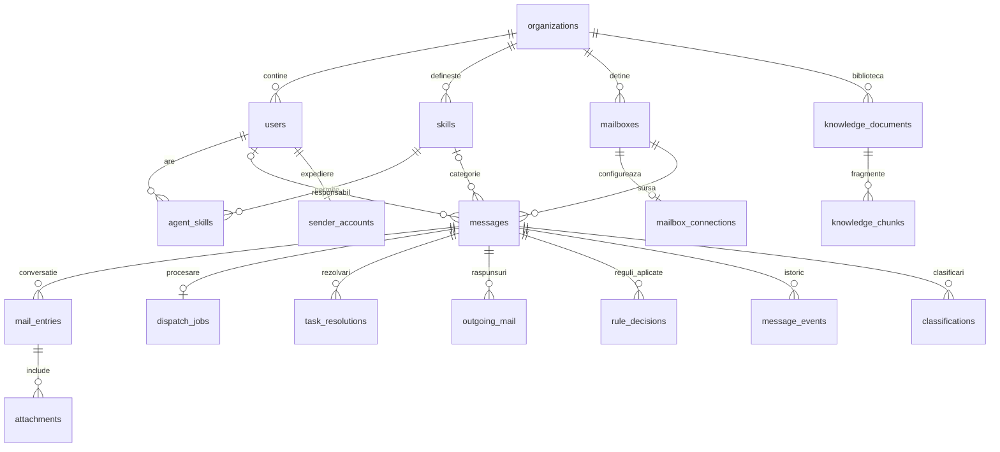

# Model de date și identificatori

[Documentație](README.md) · [Arhitectură](architecture.md) · [Operare și recuperare](operations.md)

## Sursa de adevăr

PostgreSQL este sursa datelor persistente. Migrările [001](../server/migrations/001_initial.sql), [002](../server/migrations/002_mail_learning.sql) [003](../server/migrations/003_workflows.sql) și [004](../server/migrations/004_rules_and_collaboration.sql) sunt definiția autoritativă a schemei. Tabelele sunt create la migrare; nu este necesar un Excel pentru configurarea inițială a skillurilor.

Datele organizațiilor sunt în aceeași schemă, separate prin `organization_id` și verificările backendului. Mai multe chei externe compuse păstrează asocierea dintre organizație și entitate. Acest mecanism nu este PostgreSQL Row-Level Security și nu izolează datele față de un administrator SQL privilegiat.

## Relații principale

Diagrama este conceptuală și omite unele relații pentru lizibilitate. Constrângerile complete se consultă în migrări.

## Inventarul entităților

| Tabel                     | Scop                                                                            |
| ------------------------- | ------------------------------------------------------------------------------- |
| `schema_migrations`       | Versiunile de schemă aplicate                                                   |
| `organizations`           | Organizațiile și identificatorii lor                                            |
| `users`                   | Conturi, rol, hash parolă, activare, disponibilitate, capacitate și coduri EMMA |
| `skills`                  | Competențele organizației                                                       |
| `agent_skills`            | Relația utilizator–competență                                                   |
| `classification_examples` | Exemplele inițiale configurate pentru model                                     |
| `mailboxes`               | Identitatea adresei sursă, păstrată și după eliminarea conexiunii               |
| `mailbox_connections`     | Furnizor, credențiale criptate, intervale, checkpoint și stare                  |
| `messages`                | Taskuri email/EMMA, stare, responsabil, tag și sursa confirmării                |
| `mail_entries`            | Emailurile individuale ale conversației și identificatorii de răspuns           |
| `attachments`             | Metadatele și conținutul binar local sau motivul indisponibilității             |
| `classifications`         | Rezultate AI cu model, prompt, încredere și motiv                               |
| `message_events`          | Evenimentele taskului, autor, tip și datele schimbării                          |
| `notes`                   | Note interne cu autor și dată                                                   |
| `processing_jobs`         | Coada AI istorică păstrată, neprocesată de runtime                              |
| `sessions`                | Hashul tokenului de sesiune și expirarea                                        |
| `api_keys`                | Chei de organizație pentru roboți, stocate ca hash și revocabile                |
| `emma_rules`              | Condițiile și structura rapoartelor eligibile                                   |
| `emma_imports`            | Rezultatul importului unui atașament, număr creat/ignorat și eroare             |
| `knowledge_documents`     | PDF-urile ITL și amprenta SHA-256 pentru duplicate                              |
| `knowledge_chunks`        | Fragmentele text și paginile pentru căutare                                     |

## Identificatori și deduplicare

- ID-urile de organizație, utilizator, skill, task și document sunt UUID-uri. Evenimentele au identificator numeric generat de SQL.
- `(organization_id,address)` identifică o căsuță; `(mailbox_id,external_id)` identifică un email importat.
- În Graph se cer ID-uri imuabile; în IMAP se folosește combinația UIDVALIDITY și UID. Acestea nu sunt ID-uri ale unei probleme de business.
- `thread_id`, `internet_message_id` și referințele de răspuns ajută asocierea conversației. Nu sunt o autorizație de acces.
- Un task EMMA are tipul `emma`, codul și `source_message_id` către raportul părinte. Identificatorul determinist al rândului se bazează pe atașamentul importat și numărul rândului.
- PDF-urile identice sunt deduplicate prin SHA-256 în organizație; un fișier revizuit cu alt conținut este alt document.

## Stări și decizii

| Câmp                    | Valori / semnificație                            |
| ----------------------- | ------------------------------------------------ |
| `messages.status`       | Nou, În lucru, Rezolvat                          |
| `messages.priority`     | Scăzută, Medie, Ridicată                         |
| `messages.tag_source`   | rule, human, ai (istoric) sau null               |
| `messages.task_kind`    | email sau emma                                   |
| `processing_jobs.state` | pending, running, retry, done, failed, cancelled |
| `emma_imports.state`    | done sau failed                                  |

`resolved_at` urmărește rezolvarea curentă. Redeschiderea îl golește; istoricul evenimentelor rămâne. Pentru taskurile existente la migrarea 003, data rezolvării a fost estimată din `updated_at`, deci indicatorii istorici nu constituie o măsurătoare retrospectivă exactă.

O etichetă human-confirmed este referință pentru context. Clasificările istorice nu sunt șterse când un agent corectează tagul. Evenimentele păstrează traseul schimbărilor; nu există un jurnal imuabil criptografic.

## Date sensibile și retenție

Hashurile parolelor și tokenurilor nu sunt parole/tokenuri recuperabile în clar. Credențialele de conectare la email sunt criptate AES-256-GCM; cheia este separată, în `.relay/credential.key` sau RELAY_DATA_DIR.

Corpul emailurilor, notele, PDF-urile, fragmentele și atașamentele nu au criptare aplicativă individuală. Protecția la nivel de disc, ACL, backup și infrastructură trebuie configurată de operator. Fișierele binare măresc volumul bazei și al backupurilor.

Nu există politici automate de retenție sau API general de ștergere a arhivei. Eliminarea unei conexiuni nu șterge taskurile. Ștergerea unui ITL din index elimină documentul și fragmentele lui din SQL, dar nu fișierul original de pe disc. Orice procedură de ștergere conform politicii companiei se proiectează și se validează separat, ținând cont de relații și backupuri.

## Migrare și modificări directe

`db:migrate` aplică migrările lipsă într-o tranzacție, protejată cu lock. Poate fi repetată; nu rulează bootstrapul. Nu există migrări inverse automate.

Modificarea directă a skillurilor, alocărilor sau istoricului în SQL poate ocoli validările și auditul aplicației. Pentru operații uzuale se folosește API-ul/interfața. Intervențiile SQL de recuperare se fac numai controlat, după backup, cu versiunea schemei cunoscută.

## Schema 004 — reguli și colaborare

| Tabel            | Semnificație                                                                             |
| ---------------- | ---------------------------------------------------------------------------------------- |
| dispatch_rules   | Condiții JSON, all/any, skill și prioritate, stare activă                                |
| dispatch_jobs    | Coada activă de evaluare a regulilor; lease 2 minute                                     |
| rule_decisions   | Rezultat și snapshot al regulilor potrivite; istoricul supraviețuiește ștergerii regulii |
| task_resolutions | Rezumat/pași, autor, partajare, dată; folosite lexical numai când taskul este rezolvat   |
| sender_accounts  | Cont personal, credențiale criptate, revision, o identitate per utilizator               |
| outgoing_mail    | Outbox idempotent, referințe RFC, snapshot adresare, stare și erori                      |

mail_entries.direction distinge inbound/outbound. messages.tag_source acceptă rule, human, ai sau null; ai este numai istoric. classification_examples, classifications și processing_jobs rămân în SQL, dar nu sunt consumate de workerele active. Migrarea nu recreează organizația și nu șterge modelele de pe disc.

Stările outboxului sunt queued, sending, sent, failed, unknown și cancelled. sent înseamnă acceptare de furnizor sau confirmare manuală auditată, nu dovadă automată de livrare. requestId este unic per organizație/autor; un requestId cu alt text/task este refuzat. Refacerea unei baze într-un mediu de test necesită izolarea trimiterii externe.
