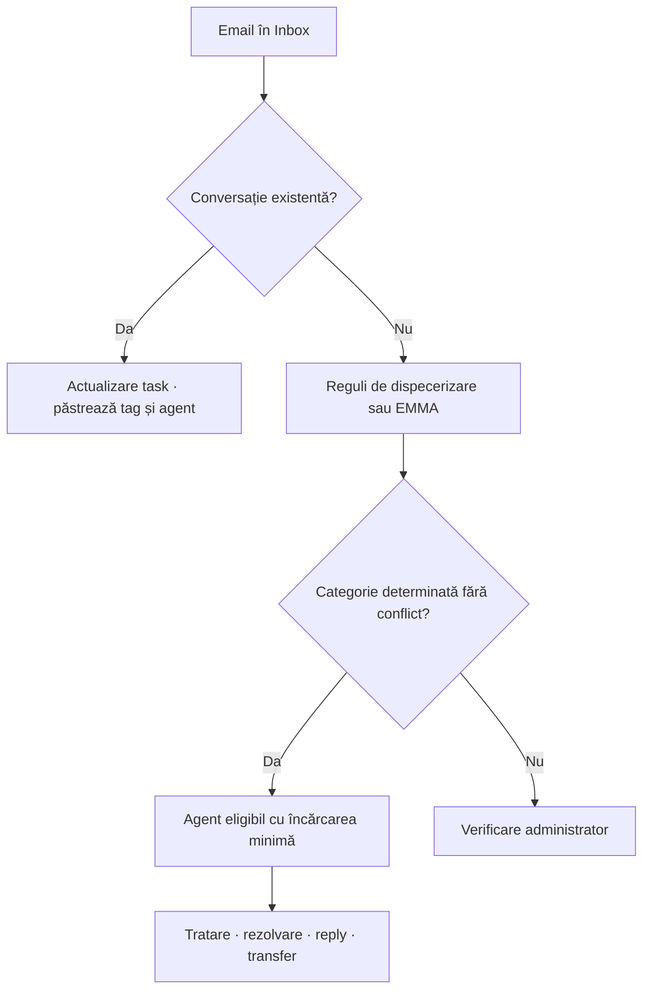

# Prezentare funcțională

[Documentație](README.md) · [Administrator](administrator-guide.md) · [Agent](agent-guide.md)

Relay gestionează solicitări email și distribuie munca indiferent de domeniu. Administratorul definește competențe și reguli explicite; agenții lucrează la taskurile proprii. Versiunea 0.2.0 nu folosește AI. Datele SQL și codul pentru o posibilă integrare viitoare sunt păstrate separat.

## Roluri și funcții

Agentul vede taskurile proprii, schimbă starea/tagul, adaugă note și rezolvări, trimite un reply din contul personal autorizat și poate preda unui coleg activ cu explicație. Administratorul configurează echipa, regulile, sursele, documentele și codurile EMMA și poate aloca manual oricui din organizație. IT administrează infrastructura, accesul și permisiunile externe.

Contul Relay este separat de Microsoft/Google/Yahoo. Citirea unei shared mailbox și expedierea din contul agentului au autorizări separate. Autentificarea Relay nu este SSO.

Regulile folosesc condiții all/any și prioritate. Compararea ignoră diacriticele și majusculele. Nu există clasificare semantică sau învățare automată din exemple. Sugestiile sunt proceduri umane partajate și fragmente ITL, găsite lexical în SQL. Agentul verifică aplicabilitatea lor.

Conversațiile folosesc ID-urile furnizorului și referințele RFC. Actualizările noi pot redeschide un task rezolvat. Atașamentele sunt descărcabile, fără execuție automată. EMMA creează un task pe rând eligibil al unui XLSX; nu grupează toate rândurile unui cod într-un singur task.

## Limite

- Polling implicit 60 secunde, loturi de până la 5 mesaje; căutare până la 20 rezultate. Nu este garantat un timp maxim de import.
- UI: pagini de 100 taskuri, API maximum 200.
- Reguli: 1–20 condiții, valoare maximum 250 caractere, prioritate 1–10000; numele atașamentului, nu conținutul său.
- Atașamente: maximum 50, până la 20 MB/fișier și 30 MB total per mesaj; MIME IMAP peste 30 MB rămâne pentru verificare manuală.
- PDF: 20 MB, 500 pagini, 800.000 caractere; fără OCR. XLSX: 10 MB comprimat / 40 MB decomprimat, 100 coloane și 10.000 rânduri/foaie; până la 1000 taskuri eligibile/fișier.
- Capacitate: implicit 20, configurabil 1–1000 taskuri deschise pentru alocare automată. Transferul/alocarea manuală poate depăși această limită.
- Email trimis: text simplu, maximum 20.000 caractere, destinatarul original, fără CC/BCC sau atașamente. Acceptarea furnizorului nu garantează livrarea și nu există garanție exact-once.

Nu sunt incluse SSO/MFA, resetarea parolelor uitate, antivirus, retenție automată, OCR, SLA, HA sau un installer complet de servicii Windows. Monitorizarea urmărește Inbox; nu citește automat Sent. Nu există deduplicare între rapoarte săptămânale distincte fără o cheie de business suplimentară. Pentru extinderea pilotului sunt necesare evaluarea IT/Cyber Security și validarea operațională.
