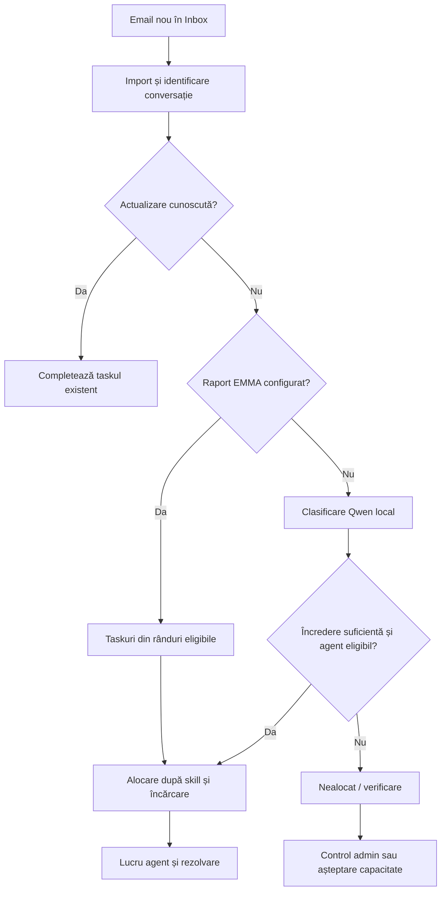

# Prezentare funcțională

[Documentație](README.md) · [Manual administrator](administrator-guide.md) · [Manual agent](agent-guide.md)

## Scop

Relay gestionează solicitări primite prin email și distribuie munca între agenți, independent de un domeniu de activitate specific. Exemple de utilizare sunt suportul intern, facturarea, administrarea contractelor și operațiunile de departament.

Modelul AI propune competența necesară. Backendul stabilește responsabilul folosind configurația curentă. Administratorul poate interveni manual, iar decizia umană asupra tagului are prioritate față de o clasificare AI care sosește ulterior.

## Roluri

| Rol                          | Responsabilități principale                                                                           |
| ---------------------------- | ----------------------------------------------------------------------------------------------------- |
| Agent                        | Lucrează la taskurile proprii, schimbă starea, adaugă note, verifică sau corectează competența        |
| Administrator                | Configurează echipa, sursele, exemplele și documentele; supraveghează coada și poate repartiza manual |
| IT / operator infrastructură | Instalează și operează platforma, conectivitatea, certificatele, serviciile și backupurile            |
| Integrator robot             | Poate trimite solicitări printr-o cheie API a organizației, conform contractului de ingestie          |

Conturile aplicației sunt distincte de conturile Microsoft/Google/Yahoo. Autorizarea citirii unei căsuțe nu autentifică automat agenții în Relay.

## Fluxul unei solicitări

Diagrama descrie traseele uzuale. Un raport EMMA atașat unui email de actualizare poate fi procesat separat prin regulile lui; lipsa unui agent disponibil nu pierde taskurile eligibile deja create.

## Reguli de distribuire

Un utilizator este eligibil pentru distribuire automată dacă este activ, disponibil, are competența necesară și nu și-a atins capacitatea. Se preferă numărul minim de taskuri deschise, incluzând celelalte competențe și taskurile EMMA. La egalitate, se preferă cel mai demult repartizat, apoi identificatorul utilizatorului.

Taskurile deschise sunt cele cu starea **Nou** sau **În lucru**. Capacitatea este o limită de taskuri deschise, nu o estimare în ore. Nu se mută automat taskuri deja alocate pentru a egaliza încărcarea. Administratorul poate face override către orice utilizator activ din aceeași organizație, inclusiv peste capacitate sau în afara competenței.

Pentru clasificarea AI, pragul curent de alocare automată este `0,75`. Încrederea declarată de model nu este o probabilitate calibrată. Taskurile cu încredere redusă rămân pentru verificare; cele clasificate suficient sau confirmate de om pot fi distribuite ulterior când apare capacitate.

## Ciclul de viață al taskului

| Stare    | Semnificație                                        |
| -------- | --------------------------------------------------- |
| Nou      | Solicitare deschisă, încă neîncepută sau redeschisă |
| În lucru | Agentul a început tratarea                          |
| Rezolvat | Tratarea curentă a fost încheiată                   |

Un răspuns nou în aceeași conversație poate redeschide un task rezolvat. Agentul și competența se păstrează. Corectarea la o competență diferită readuce taskul la Nou și reia distribuirea fără Qwen; taskul poate ieși din lista agentului inițial.

## Funcții de sprijin

| Funcție                | Comportament disponibil                                                                        |
| ---------------------- | ---------------------------------------------------------------------------------------------- |
| Exemple de clasificare | Configurabile în SQL prin interfață; context selectat din exemple și confirmări umane          |
| Conversație            | Emailuri legate prin identificatori de conversație sau antete de răspuns, nu doar prin subiect |
| Atașamente             | Copii locale descărcabile din taskurile accesibile utilizatorului                              |
| Note                   | Colaborare internă; nu trimit emailuri                                                         |
| ITL                    | PDF-uri cu text, căutare lexicală și pași AI citați; nu execută acțiuni                        |
| EMMA                   | Rânduri XLSX selectate determinist după codurile agenților, fără clasificator AI               |
| Dashboarduri           | Totaluri și încărcare din taskurile accesibile; flux pe 7 zile și timp mediu de rezolvare      |
| Istoric                | Evenimente despre task, clasificări și intervenții; nu este un jurnal de securitate complet    |

## Capacități și limite configurate

Valorile de mai jos sunt limite ale implementării, nu garanții de performanță. În documente, MB se referă la pragurile de octeți din cod, nu la o dimensiune comercială garantată a fișierului după toate codificările email.

| Element                           | Valoare curentă                                                                               |
| --------------------------------- | --------------------------------------------------------------------------------------------- |
| Verificare email                  | Implicit 60 secunde; configurabil 30–3600 secunde                                             |
| Istoric opțional la creare        | 1–90 zile, implicit 1; start-now nu importă acest istoric                                     |
| Lot monitorizare                  | Se solicită până la 5 mesaje, apoi se continuă de la checkpoint                               |
| Căutare în Inbox                  | Până la 20 rezultate; importul este explicit                                                  |
| Pagină UI                         | 100 taskuri; API acceptă limită de până la 200                                                |
| Competențe pentru fluxul AI local | 1–60                                                                                          |
| Context de clasificare            | Până la 6 exemple, maximum 2 pe competență; corp email pentru model de maximum 6000 caractere |
| Atașamente                        | Maximum 50, până la 20 MB per fișier și 30 MB total per mesaj                                 |
| Sursă MIME IMAP                   | Peste 30 MB nu se descarcă automat corpul; rămân metadatele/indicația manuală                 |
| PDF ITL                           | Maximum 20 MB, 500 pagini, 800.000 caractere; până la 100 fișiere la o scanare de folder      |
| XLSX EMMA                         | Maximum 10 MB comprimat / 40 MB decomprimat, 100 coloane și 10.000 rânduri per foaie          |
| Taskuri dintr-un XLSX             | Maximum 1000 rânduri eligibile per fișier                                                     |
| Capacitate agent                  | Implicit 20; configurabil 1–1000 taskuri deschise                                             |
| Inferență                         | O cerere comună la un moment dat pentru clasificare/test/ITL; timeout implicit 300 secunde    |

## Glosar

| Termen                   | Definiție                                                                                                                                      |
| ------------------------ | ---------------------------------------------------------------------------------------------------------------------------------------------- |
| Organizație              | Limita logică a datelor unei firme/echipe, identificată prin UUID                                                                              |
| Competență / skill / tag | Categoria necesară pentru rezolvarea solicitării                                                                                               |
| Căsuță / mailbox         | Adresa sursă a emailurilor; separată de configurația de conectare                                                                              |
| Checkpoint               | Punctul persistent până la care a avansat monitorizarea                                                                                        |
| ITL                      | Instrucțiune tehnică de lucru, furnizată ca document PDF                                                                                       |
| EMMA                     | Denumirea procesului de raportare a erorilor tarifare folosit în pilot; aplicația configurează coduri, nu cunoaște implicit regulile companiei |
| Inferență                | Executarea modelului local pentru un răspuns; nu înseamnă reantrenare                                                                          |
| Context                  | Fragmente/exemple trimise modelului la o cerere                                                                                                |

## Limite de produs

Nu sunt incluse trimiterea răspunsurilor, procesarea folderului Sent, SSO/MFA, resetarea parolelor uitate, OCR, antivirus, retenție automată, distribuirea unui executabil complet sau instalarea serviciilor Windows. Nu există un model antrenat pe datele companiei și nici o garanție de clasificare corectă.

Deduplicarea aceluiași email sau atașament procesat nu reprezintă deduplicarea aceleiași probleme de business în rapoarte săptămânale diferite. Pentru aceasta trebuie stabilită o cheie, de exemplu contract + cod + perioadă. Nu există SLA, dimensionare sau disponibilitate ridicată validate în versiunea pilot.
